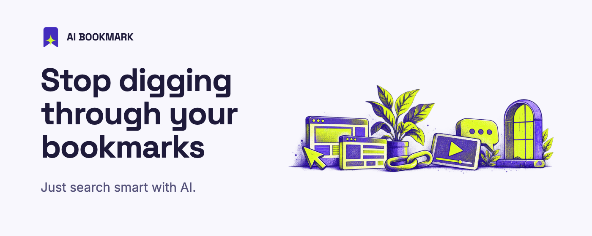
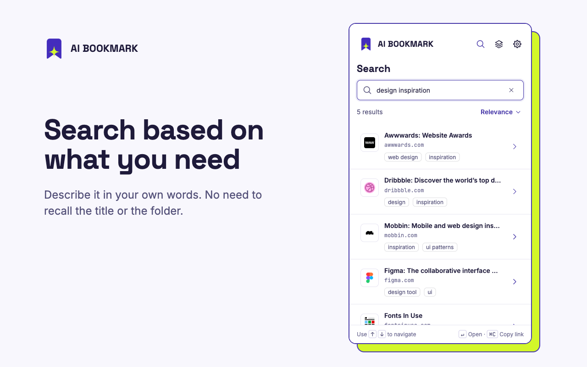
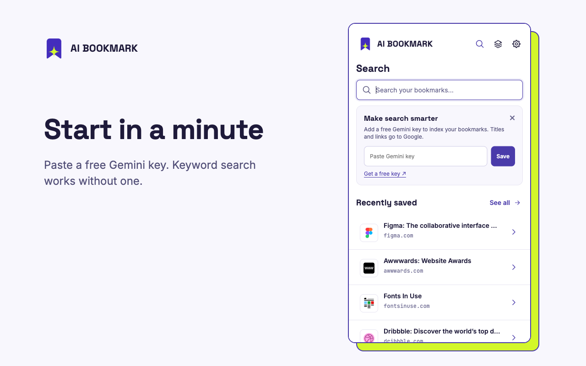
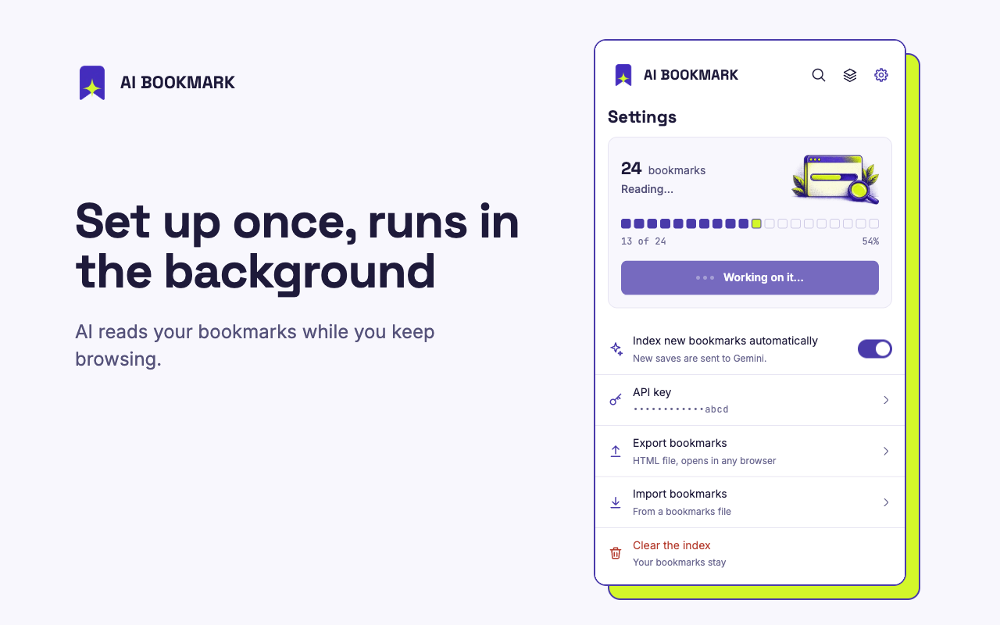
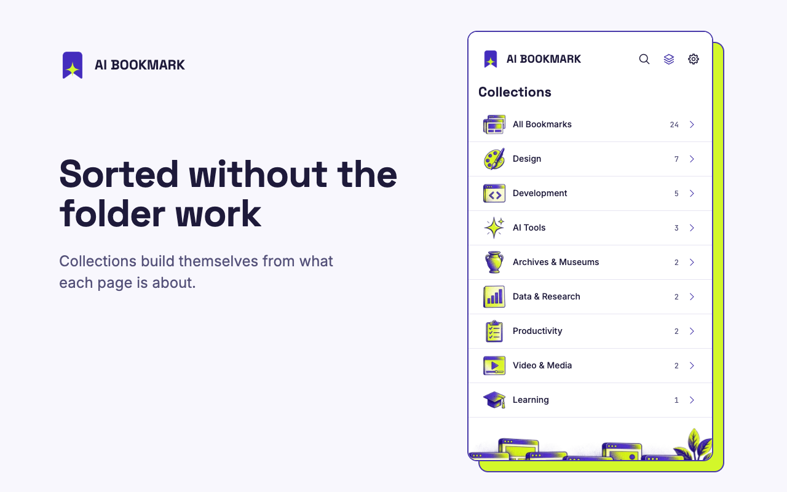
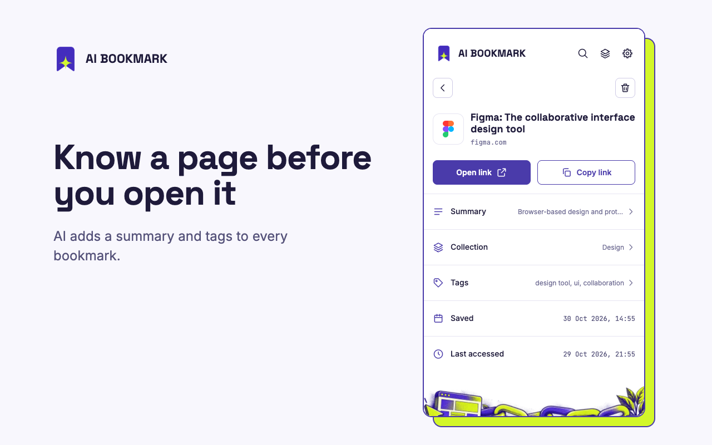

<p align="center">
  
</p>

# AI Bookmark

**Stop digging through your bookmarks. Just search smart with AI.**

You save many pages. After some time, you cannot find them. You nest your folders. You sort some of them, not all. You remember what a page was about. You do not remember its title or its folder.

AI Bookmark is a Chrome extension for this problem. Gemini reads the pages you save. Then you search by what a page is about. Type "design inspiration". The extension shows the sites that fit. It does this when those words are not in the title.

<p align="center">
  
</p>

## Install

The extension is not in the Chrome Web Store yet. Until it is, install it by hand. You do not need a build step.

1. Download or clone this repository.
2. Open the extensions page of your browser (`chrome://extensions`).
3. Set **Developer mode** to on.
4. Click **Load unpacked**. Select the repository folder.
5. Open the puzzle-piece menu. Pin **AI Bookmark**.

You need a Chromium browser, version 116 or later.

## First run

1. Click the icon. The side panel opens.
2. Search for a word. Keyword search works at once, with no key.
3. For search by meaning, create a free key in [Google AI Studio](https://aistudio.google.com/apikey).
4. Paste the key into the card on the Home screen. Click **Save**. Indexing starts at once.
5. Read the progress on the Home card or in Settings. You can close the panel. Indexing continues in the background.

<p align="center">
  
  
</p>

## Use

| Task | Action |
| --- | --- |
| Open the panel | Click the icon. Or press `Ctrl+Shift+K` (`Cmd+Shift+K` on a Mac). |
| Search | Type in the search box. Press `Enter`. |
| Move in the results | Press the up or down arrow. Press `Enter` to open a link. |
| Copy a link | Select a result. Press `Ctrl+C` or `Cmd+C`. |
| Browse by collection | Click the layers icon. |
| Change a summary, a collection or the tags | Open a bookmark. Tap the row. |
| Delete a bookmark | Open it. Click the bin icon. Click **Undo** within seven seconds to restore it. |
| Index new bookmarks | The extension does this by itself. You can switch it off in Settings. Then Settings shows how many new bookmarks it found. Click **Sync now**. |
| Export | Open Settings. Click **Export bookmarks**. |
| Clear the index | Open Settings. Click **Clear the index**. Your bookmarks stay. |

<p align="center">
  
  
</p>

## How it works

1. **Index.** Gemini reads each page. It writes a summary, tags and a collection. The extension then makes a numeric search index from the title, the tags and the summary.
2. **Search.** The extension first matches your query against the data on your device. A result shows at once. In parallel, it compares the meaning of your query with the index. Then it updates the list.
3. **Pages it cannot read.** Some pages are web apps with no text, or they need a login. For these pages the extension stores no summary. It does not guess.
4. **Local data.** The index stays in your browser. Without a key, the extension sends nothing. Keyword search and the automatic collections still work.

## Privacy

The extension has no server, no analytics and no advertising. The index and the API key stay in your browser.

When you use Gemini, the extension sends this data to Google:

- The title, the address and the folder of each bookmark. Gemini also reads the page.
- The tags and the summary that Gemini wrote. They build the search index.
- Your search text. This includes the text you type before you press `Enter`.

You can switch off automatic indexing. Then the extension sends no new bookmark until you click **Sync now**. Read [PRIVACY.md](PRIVACY.md) for the full policy.

## Permissions

| Permission | Reason |
| --- | --- |
| `bookmarks` | Read your bookmarks. Restore a bookmark after you delete it. |
| `storage`, `unlimitedStorage` | Keep the index on your device. |
| `sidePanel` | Show the side panel. |
| `favicon` | Show the icon of each site. |
| `generativelanguage.googleapis.com` | Call the Gemini API. The extension calls no other address. |

## Limits

- Search by meaning needs a Gemini key. The free tier has rate limits. A large library can need several minutes to index.
- A page that needs a login, or that builds its content with scripts, often cannot be read. It gets a title and a collection. It gets no summary.
- Each browser profile keeps its own index. The index does not sync between devices.

## Project files

```
├── manifest.json          # Extension settings
├── background.js          # Indexing, search and the Gemini calls
├── popup.html             # Side panel page
├── popup.js               # Side panel interface
├── popup.css              # Styles and design tokens
├── assets/                # Pictures and collection badges
├── fonts/                 # Inter, Space Grotesk, JetBrains Mono
├── icons/                 # Extension icons
├── store/                 # Store screenshots and promo images
├── DESIGN.md              # Design rules
├── PRIVACY.md             # Privacy policy
├── CHROME_WEB_STORE.md    # Text and steps for the store listing
└── LICENSE                # MIT
```

## Develop

The project has no dependencies. Edit a file. Open the extensions page. Click the reload icon on the extension card.

To test as a new user, uninstall the extension. Install it again. The browser deletes the saved data.

Follow [DESIGN.md](DESIGN.md) for interface work. Use the tokens at the top of `popup.css`.

## Licence

MIT. See [LICENSE](LICENSE).
